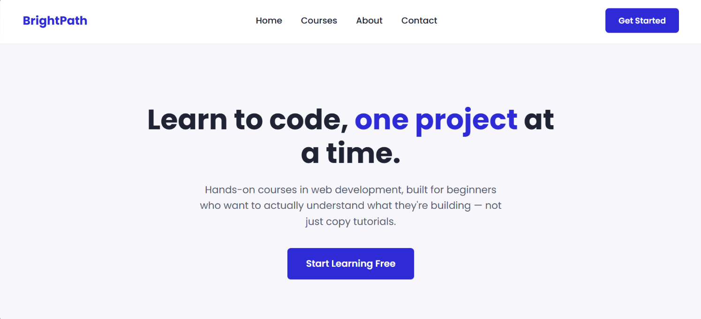
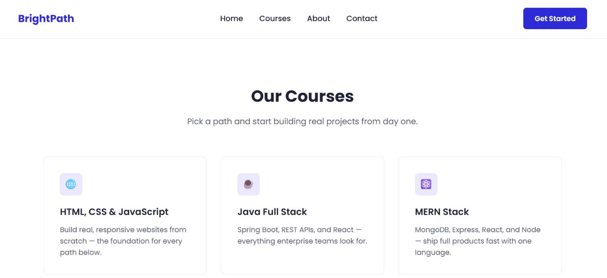
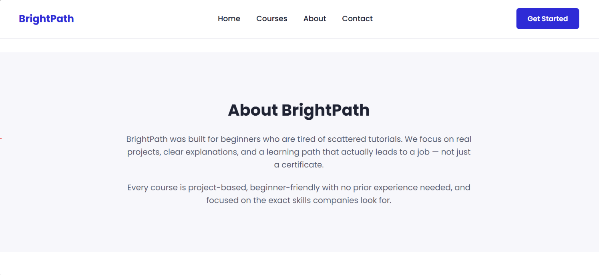
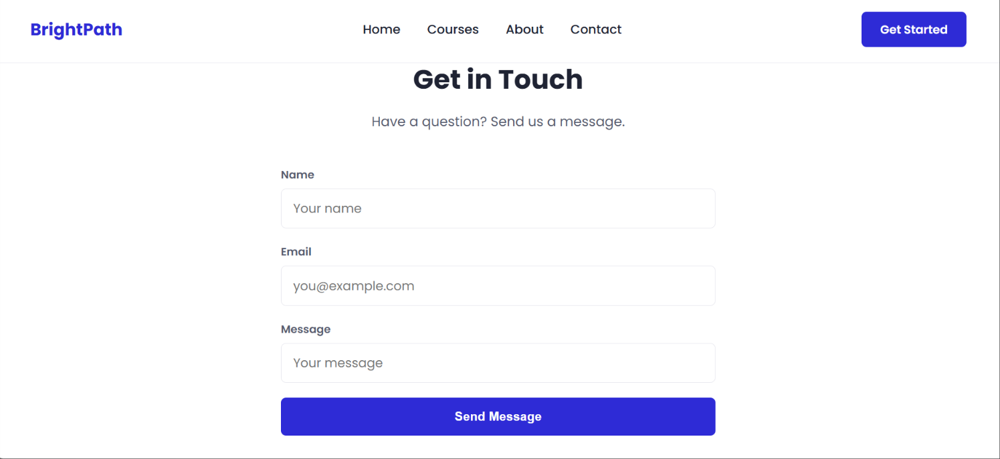
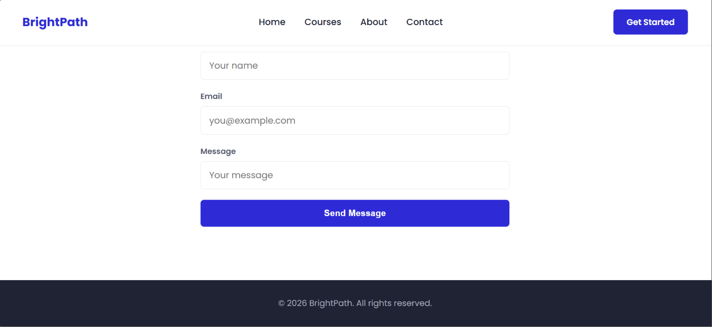

# BrightPath

A clean and responsive learning platform landing page built using HTML5 and CSS3 as a frontend learning project.

## 📌 About the Project

BrightPath is a learning platform landing page designed for beginners who want to learn coding through practical, project-based courses.

The website includes a navigation bar, hero section, course cards, about section, contact form, and footer.

The project focuses on creating a clean user interface, responsive layout, smooth scrolling, and interactive visual effects using HTML and CSS.

## ✨ Features

* Responsive navigation bar
* Hero section with call-to-action button
* Course cards for different learning paths
* About section
* Contact form
* Smooth scrolling navigation
* CSS hover effects
* Responsive layout for different screen sizes
* Clean and modern user interface
* Google Fonts integration

## 🛠️ Technologies Used

* HTML5
* CSS3
* Google Fonts (Poppins)

## 📂 Project Structure

```text
brightpath/
│
├── index.html
├── styles.css
├── README.md
└── screenshots/
    ├── home-page.png
    ├── courses-page.png
    ├── about-page.png
    ├── contact-page.png
    └── footer-page.png
```

## 🚀 How to Run

1. Clone this repository:

```bash
git clone https://github.com/Lokeswari684/brightpath.git
```

2. Open the project folder.

3. Open `index.html` in a web browser.

No additional installation or dependencies are required.

## 🎯 Learning Outcomes

Through this project, I practiced:

* Structuring webpages using semantic HTML
* Creating navigation links between page sections
* Building responsive layouts using CSS
* Using Flexbox and CSS Grid
* Creating hover effects and CSS transitions
* Working with forms and input elements
* Using media queries for responsive design
* Integrating Google Fonts
* Improving spacing, typography, and visual presentation

## 📸 Project Preview

### Home Page



### Courses Section



### About Section



### Contact Section



### Footer



## 👩‍💻 Author

**Lokeswari Gonugunta**

GitHub: [Lokeswari684](https://github.com/Lokeswari684)
